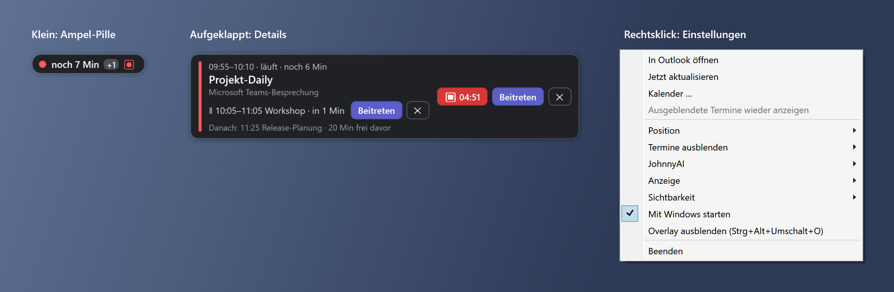

# Nächster Termin (NextMeetingOverlay)

Kleines Windows-Overlay, das den nächsten Outlook-Termin anzeigt – als unauffällige Ampel-Pille am Bildschirmrand, mit Details bei Mausberührung.

*A tiny always-on-top Windows overlay showing your next Outlook meeting as a traffic-light pill (German UI).*



## Funktionen

- **Ampel-Pille:** grün = mehr als 2 Std frei · gelb = Termin in ≤ 2 Std · rot = in ≤ 15 Min oder läuft (blinkt in der letzten Minute) · „+1“ bei überschneidenden Terminen
- **Details** bei Mausberührung oder Klick: Uhrzeit, Countdown, Ort, parallele Termine, Folgetermin mit freier Zeit, Tagesübersicht
- **„Beitreten“-Knopf** für Teams-, Zoom-, Meet- und Webex-Links
- **Filter:** als „frei“ markierte Blocker, Stichwörter (Mittag, Pause, …), ganztägige, abgesagte, private Termine – alles einzeln schaltbar
- **Andocken** oben links / Mitte / rechts, auf jedem Monitor
- **Bei Bildschirmfreigabe unsichtbar:** In Teams-/Zoom-Freigaben und auf Screenshots sehen andere das Overlay nicht – du schon
- **Bei Vollbild/Präsentation** automatisch ausgeblendet
- **Tastenkürzel** (Strg+Alt+Umschalt + O/J/A/K): ein/aus, beitreten, Aufnahme, Klick-durch-Modus
- **Optional: [JohnnyAI](https://github.com/HiSchuminator/JohnnyAI)-Steuerung** – Aufnahme mit dem Termin verknüpft starten/stoppen, Aufnahmestatus in der Pille, bei Terminbeginn anbieten oder automatisch starten. Ist JohnnyAI nicht installiert, blendet das Overlay Menü, Knopf und Tastenkürzel dafür automatisch aus.

## Kalenderquellen

| Outlook | Einrichtung |
|---|---|
| Klassisches Outlook | nichts zu tun – das Overlay liest den geöffneten Kalender direkt (COM) |
| Neues Outlook / Outlook im Web | ICS-Link hinterlegen: Outlook → Einstellungen → Kalender → Freigegebene Kalender → „Kalender veröffentlichen“ → ICS-Link kopieren → im Overlay Rechtsklick → **Kalenderquelle …** |

Der ICS-Link wird mit Windows DPAPI verschlüsselt gespeichert und funktioniert nur unter dem Windows-Konto, das ihn eingetragen hat. Wer den Link kennt, kann den Kalender lesen – nicht weitergeben.

## Installation

Unter [Releases](../../releases) die `NextMeetingOverlay.exe` herunterladen und starten. Keine Installation, kein .NET nötig (portable, self-contained).
Einstellungen landen im Ordner `NextMeetingOverlay-Daten` neben der Exe. Autostart: Rechtsklick → „Mit Windows starten“.

## Selbst bauen

Voraussetzung: .NET 8 SDK (Windows).

```bash
dotnet publish -c Release -p:Portable=true -o portable
```

Ohne `-p:Portable=true` entsteht eine kleine Exe (< 1 MB), die eine installierte .NET-8-Desktop-Laufzeit braucht und ihre Einstellungen unter `%APPDATA%\NextMeetingOverlay` ablegt.
`--profile <name>` startet eine getrennte Instanz mit eigenen Einstellungen (zum Testen).
`--demo-screenshot docs/screenshot.png` erzeugt das Bild oben neu – mit erfundenen Beispielterminen, ohne Kalenderzugriff.

## Lizenz

[MIT](LICENSE)
